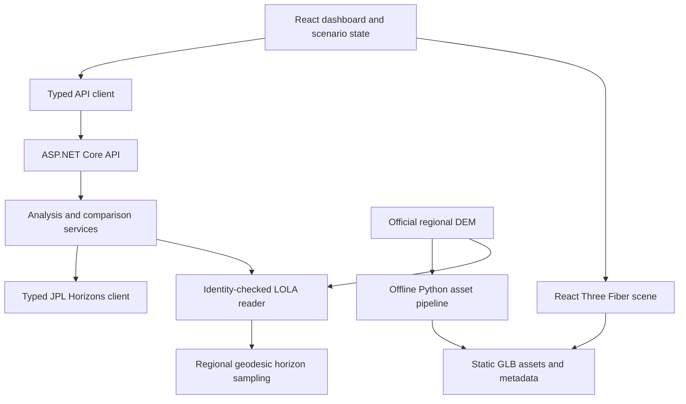

# Architecture

Lunar Navigator separates visual exploration from numerical evidence. The browser never infers scientific visibility from a rendered shadow.

## Code boundaries

| Location | Responsibility |
|---|---|
| `frontend/src/app`, `frontend/src/features` | Scenario inputs, exploration, charts, timeline, comparison, methodology and exports |
| `frontend/src/api`, `frontend/src/integration` | Typed HTTP boundary, contract regression tests and integration tests |
| `backend/LunarNavigator.Api` | HTTP endpoints, dependency composition and configuration |
| `backend/LunarNavigator.Models` | Shared typed observations and models |
| `backend/LunarNavigator.Horizons` | NASA request construction, parsing and validation |
| `backend/LunarNavigator.Core` | Coordinates, terrain, horizon, analysis and comparison |
| `data`, `data-pipeline` | Acquisition, raster validation and offline mesh/derived asset generation |
| `scripts` | Local orchestration, identity-bound runtime publication and repository checks |
| `contracts` | OpenAPI, JSON schemas, types, fixtures and coordinate/scene interfaces |

The local launcher runs the API on 5080, a restricted static server on 5081 and Vite on 5173. Reviewed runtime assets live under `.validation/runtime-assets`; raw DEMs are not served as frontend files. Build outputs and receipts are local generated artifacts, not authoritative source contracts.

## Data flow and trust

A scenario supplies a site and UTC interval. The API validates it, obtains airless apparent Sun/Earth disc-center directions and, where the exact reviewed DEM and epoch permit, computes a sampled regional horizon. Analysis exposes provenance and limitations with the result. Comparison composes scenario analyses; it must not turn unknown inputs into a recommended winner.

The HTTP client uses TypeScript casts for decoded responses, not runtime schema validation. Contract regression tests check compatibility separately; compile-time typing does not validate an arbitrary server payload.

Map metadata binds coordinate transforms and source identity to generated geometry. Reviewed local meshes allow picking on real mesh triangles, not on an invented plane. Full-globe SVS imagery is muted visual orientation, not verified polar photography. The polar cap uses its own DEM-derived cartographic material: default runtime preparation publishes 2048² RGBA relief from averaged native heights and gradients, with no additional geometry displacement. Its identity and limits are recorded in [asset acquisition](science/ASSET_ACQUISITION.md).

Camera-anchored Sun/Earth ornaments are removed. Before Analyze there are no sky bodies. Globe markers require a real, exact cached Analyze sample with JPL provenance, verified Globe geometry and finite observer height, using the shared UTC and optional Site A/B reference. Airless apparent azimuth/elevation becomes an ENU direction, then a Moon_ME vector, then scene `(Y, -Z, -X)`; markers remain fixed in world direction rather than following the camera. See [coordinate details](COORDINATES_AND_TILES.md#sky-direction-markers).

The canonical API does not supply real orbital distances. The 8R endpoint distance and symbol radii are display-only, not actual celestial positions, phase or physical scale. Markers may be offscreen or occluded; there is no forced always-onscreen placement. Short arrows at the selected site indicate actual bearing. TerrainView uses a compass and cached Sun lighting, without global vector-endpoint claims. Rendered lighting and markers do not establish scientific visibility; real-source global visibility remains unknown.

## Product scope

The API computes a regional horizon from finite terrain samples. Global visibility remains unknown even when regional clearance is available.

Do not infer production-wide LOD coverage, verified site imagery, complete illumination windows, automatic landing-site ranking or operational deployment from the presence of UI controls or offline pipeline modules. The current source/epoch/coverage policy is described in [data and science](DATA_AND_SCIENCE.md).

Canonical interfaces are in [contracts](../contracts/), with a concise [API convention guide](API_CONTRACT.md).

## Frontend composition

`Application.tsx` is the composition root. `useWorkspace.ts` owns the single API client, scenario drafts, cancellation identity, cached results and selected UTC. `WorkspaceSlots.tsx` adapts that state to independently testable feature components. `errorMessage.ts` formats structured failures without depending on React. Features do not create additional global scenario stores or alternate application entry points.
