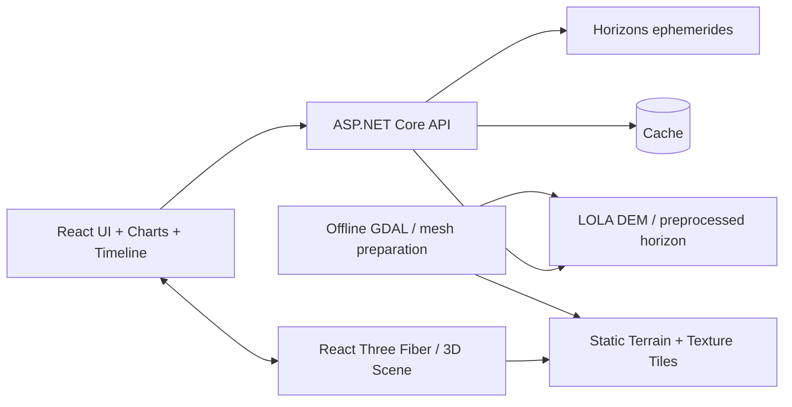

# LUNAR NAVIGATOR — спільне ТЗ та API-контракт

**Проєкт:** NASA Space Apps Challenge 2026 · Lunar Landing Site Navigator  
**Версія:** 1.0 (проєктний контракт для узгодження командою) · **Дата:** 14.11.2026  
**Команда:** 5 учасників · **Стек:** React/TypeScript + React Three Fiber/Three.js + ASP.NET Core (.NET 8) + NASA Horizons + LOLA  
**Статус:** **ПЛАН / PROPOSAL**, не документація вже реалізованих ендпоінтів. JSON нижче — **ілюстративний**, а не реальні вимірювання NASA.

> **Суть за 30 секунд.** Створюємо вебзастосунок, що дозволяє вибрати до двох сценаріїв посадки у районі південного полюса Місяця (місце + період часу), наочно побачити Сонце й Землю щодо місцевого горизонту, оцінити інтервали освітлення та прямої геометричної видимості Землі, швидко порівняти сценарії. Центральний елемент — **плавна інтерактивна 3D-поверхня**, а не глобус усього Місяця.

## Зміст

1. [Мета, межі та пріоритети](#1-мета-межі-та-пріоритети)
2. [Візуальна концепція та UX](#2-візуальна-концепція-та-ux)
3. [Технології та архітектура](#3-технології-та-архітектура)
4. [Дані та наукова модель](#4-дані-та-наукова-модель)
5. [Правила обміну даними](#5-правила-обміну-даними)
6. [Повний перелік маршрутів](#6-повний-перелік-маршрутів)
7. [Контракти API з прикладами](#7-контракти-api-з-прикладами)
8. [3D-рельєф і візуальні тіні](#8-3d-рельєф-і-візуальні-тіні)
9. [Розподіл роботи на п'ятьох](#9-розподіл-роботи-на-пятьох)
10. [Порядок реалізації й критерії готовності](#10-порядок-реалізації-й-критерії-готовності)
11. [Ризики, відкриті рішення та джерела](#11-ризики-відкриті-рішення-та-джерела)

---

## 1. Мета, межі та пріоритети

### Відповідь на завдання NASA

NASA просить зробити **зрозумілий інструмент швидкого порівняння місць і дат посадки**, який показує положення Сонця й Землі відносно горизонту. Це допомагає оцінювати **потенціал сонячного енергозабезпечення** та **вікна прямої видимості Землі**. Реальна топографія, 3D та анімації — дозволені способи реалізації, але не жорстка вимога офіційного опису.

### Обрана командна концепція

- **Регіон MVP:** лише **80°S–90°S** (широта від −90° до −80°); це зона основного DEM, який ми розглядаємо. Місця Apollo за межами цієї території не вносимо в робочий список.
- **Вибір місця:** кліком на 3D-поверхні, ручним введенням широти/довготи або з перевіреного каталогу.
- **Вибір часу:** дата/час UTC, початок/кінець періоду, крок вибірки.
- **Аналіз:** положення Сонця й Землі, рельєфний горизонт, пряма видимість, тривалість і вікна видимості, часові ряди.
- **Порівняння:** два різні місця в однаковий час **або** одне місце у різні періоди.
- **3D як інструмент:** оглядова поверхня полюса, плавна камера, деталізація за наближенням, маркери, рух умовного освітлення; основне рішення про видимість — **на сервері**, не за тінями Three.js.

### Пріоритети

| Рівень | Робимо |
|---|---|
| **P0 — робоче ядро** | Реальна карта/рельєф хоча б однієї підготовленої ділянки; вибір місця/дати; `analyze`; графіки; вікна освітлення/зв'язку; `compare`; якісна API-інтеграція |
| **P1 — сильна демонстрація** | Багаторівневі 3D-тайли всього обраного регіону, візуальні тіні за датою, анімований час, інтерактивний профіль горизонту, підвантаження детальніших районів |
| **P2 — за залишковим часом** | Науково розрахована маска тіней для цілих областей, автоматичний пошук дат, рейтинг із пояснюваними критеріями, експорт звіту |

**Не витрачати час:** повна куля Місяця, авторизація, особисті кабінети, база профілів, безкінечний набір картографічних режимів. Ставимо на точність і зрозумілість порівняння.

---

## 2. Візуальна концепція та UX

**Назва концепції:** Lunar Mission Control / Lunar Navigator.  
**Візуальний стиль:** стриманий science/space dashboard, глибокі темно-сині/графітові фони, сіра місячна поверхня, **жовтий = Сонце**, **блакитний = Земля**, зелений = позитивний стан. Числа і координати — моноширинним шрифтом. Плавність важливіша за декоративні ефекти.

**Desktop:**

- **Центр (головний простір):** велика реальна **3D-ділянка південного полюса** з orbit/pan/zoom, нахилом камери, zoom-to-site, вибором точок A/B, підвантаженням LOD.
- **Ліва панель:** каталог перевірених місць, координати, дата/час, період, кнопки «Аналізувати», «Додати B», «Порівняти».
- **Права панель:** висота/азимут Сонця й Землі, видимість/закриття рельєфом, часові підсумки, джерела/застереження.
- **Нижня широка смуга:** **Mission Timeline**, графіки, інтервали освітлення та прямої видимості Землі; scrub-повзунок часу, Play/Pause.
- **Режим Compare:** 2 узгоджені панелі A/B, спільні або співставлені часові шкали, різниці за показниками, без необґрунтованого «переможця».

**Mobile:** 3D-сцена зверху, налаштування й аналіз у bottom sheet; великі touch targets; запасний режим 2D/спрощеної геометрії для слабких GPU; підтримка `prefers-reduced-motion`.

**Важливі UX-правила:**

1. Один клік по поверхні → координати → один явний запуск аналізу (або debounce для швидкого попереднього перегляду).
2. Рух часового повзунка **не створює HTTP-запит на кожен кадр**: використовує вже завантажені `samples` / `ephemeris` та інтерполяцію в UI.
3. Нічого не вигадувати: якщо DEM відсутній або обчислення часткове, показувати **«Рельєф не враховано»** замість зеленої «доступності».
4. Коли дані відомі лише для дискретних часових кроків, показувати точність/похибку часових меж.

---

## 3. Технології та архітектура

| Підсистема | Рішення | Відповідальність |
|---|---|---|
| Frontend | React + TypeScript + Vite | Інтерфейс, стан, HTTP-клієнт |
| 3D | Three.js + React Three Fiber | Геометрія, LOD, камера, маркери, **візуальне** освітлення |
| Графіки/UI | Chart.js, Motion (опційно) | Часові ряди, timeline, анімація панелей |
| Backend | C# + ASP.NET Core Web API (.NET 8) | REST, валідація, кеш, обчислення |
| Ефемериди | JPL Horizons (або перевірений попередній розрахунок) | Сонце/Земля в часі |
| Висоти | NASA LOLA DEM (GeoTIFF/COG) + GDAL | Висота точки, профіль горизонту, рельєфні перешкоди |
| Орбітальні знімки | LROC (перевірити ліцензію/умови) | Візуальна текстура поверхні |
| Статичні файли | Nginx / CDN / object storage | `.glb` і `.webp`; **не** генерувати кожен тайл у вебзапиті |



### Логічні модулі .NET

- `EphemerisService`: запит/парсинг Horizons, трансформації й кеш.
- `TerrainService`: читання DEM, координати, висота ділянки, NoData.
- `HorizonService`: азимутальний профіль локального горизонту з урахуванням відстані й кривизни Місяця.
- `AnalysisService`: поєднання ефемерид із профілем, часові інтервали, summaries.
- `ComparisonService`: 2 × analysis, різниці, статуси достовірності.
- `MapAssetsPipeline` (offline, не request-time): підготовка текстур/GLB/LOD/metadata.

### Рекомендована структура репозиторію

```text
lunar-navigator/
├── frontend/                 # React + TS, app, scene, components, API types
│   └── src/
│       ├── api/
│       ├── features/explorer/
│       ├── features/analysis/
│       ├── features/compare/
│       └── shared/
├── backend/                  # ASP.NET Core, Services, DTO, tests
│   ├── LunarNavigator.Api/
│   ├── LunarNavigator.Core/
│   └── LunarNavigator.Api.Tests/
├── data-pipeline/            # офлайн-скрипти DEM -> тайли/mesh
├── contracts/                # OpenAPI, sample JSON, fixtures
├── infra/                    # Nginx / deployment
└── docs/
```

---

## 4. Дані та наукова модель

### 4.1. LOLA

Основний набір для всієї обраної області: `LDEM_80S_80MPP_ADJ.TIF` (південна полярна стереографічна проєкція, ~80 м/піксель, область до 80°S). Цифрові висоти використовуються для **геометрії рельєфу** й **профілю місцевого горизонту**. Окремі районні DEM із 5 м/піксель можливі як P1, а не обов'язкові всюди.

- Витягати реальний CRS/трансформацію та NoData з **метаданих GeoTIFF**, не трактувати місячні координати як земний WGS84.
- Вказати опорну сферу/систему координат і що саме означають висоти. Для **Horizons `SITE_COORD` висота задається в кілометрах** над його опорною поверхнею; для DEM — значення у метрах, що **потребують коректного зіставлення**, а не простого підставляння.
- Для затінення врахувати **кривизну Місяця і перепад висот** уздовж напрямку на небесне тіло. Просте порівняння висоти сусіднього пікселя із висотою точки — недостатнє.
- Прогалини DEM, край покриття й просторове розрізнення мають відображатися у `quality` / warnings.

### 4.2. Horizons

Для аналізу потрібні топоцентричні **азимут і кутова висота** Сонця та Землі в певній місячній точці. Технічно: `EPHEM_TYPE=OBSERVER`, місячний спостерігач типу `CENTER='coord@301'`, `SITE_COORD='longitude,latitude,heightKm'`, `QUANTITIES='4'` (точний формат і режим — перевірити на одному реальному запиті). Для Сонця `COMMAND='10'`, для Землі `COMMAND='399'`. Система довгот, обертання та звітні осі мають збігатися з LOLA після трансформації.

Для 3D-підсвітки великого регіону можна використовувати **єдиний Moon-fixed напрямок** на Сонце/Землю (`/ephemeris`), але його отримання/перетворення — окреме завдання. Не можна назвати довільний локальний ENU-вектор глобальним Moon-fixed.

### 4.3. Розрахунок видимості

Для кожного часу й тіла:

1. Horizons → `azimuthDeg` і `elevationDeg` щодо локальної горизонтальної площини.
2. LOLA → горизонт у напрямку `azimuthDeg`: `horizonDeg`.
3. `clearanceDeg = elevationDeg - horizonDeg`.
4. Спрощено: **центр тіла видно**, якщо `clearanceDeg > 0`.
5. З послідовності розрахунків отримати `intervals` і `summary`.

**Наукові застереження:** це геометрична модель. Для Сонця варто визначити, чи враховуємо частково видимий сонячний диск, і за потреби інтерполювати час перетину горизонту; Земля також має видимий диск. «Земля видима» = потенційна пряма лінія видимості, **не гарантія якості радіозв'язку**. «Сонце видиме» = потенційне пряме освітлення, **не прогноз потужності конкретної панелі**. 3D-графічні тіні ≠ доказ наукового статусу точки.

---

## 5. Правила обміну даними

**База API:** `/api/v1` · **Формат:** JSON `camelCase` · **Час:** UTC ISO-8601 (`...Z`) · **Кути:** градуси · **Висота:** метри щодо явно вказаної місячної опорної поверхні, **не метри над земним рівнем моря**.

- Широта `[-90,-80]` для робочого DEM; довгота нормалізована до `[-180,180]` (якщо джерело використовує `0..360`, сервер конвертує). Заявлена підтримка всієї області залежить від покриття DEM і texture tiles.
- `azimuthDeg` у `[0,360)`, **0° = локальна північ, 90° = схід** (нормалізацію з Horizons/системи Moon відтестувати; біля самого полюса потрібна окрема конвенція).
- `elevationDeg`: висота тіла над геометричною локальною горизонтальною площиною. `horizonDeg`: висота **рельєфного** горизонту по тому ж азимуту. `visible`: із рельєфом лише якщо `quality.terrainApplied = true`.
- Часові ряди відсортовані зростанням; `endUtc > startUtc`; `stepMinutes > 0`; сервер обмежує максимум зразків із `/config`.
- Інтервали `[startUtc, endUtc)` — **кінець виключений**; часові межі відповідають роздільності розрахунку, а не секундній точності.
- `samples` і `summary` містять **наукові дані**; `.glb`/`.webp` — **візуальні ресурси**.
- Для `compare`: різниця `B − A`; якщо тривалості періодів різні, абсолютні години порівнювати тільки із зазначеними тривалостями (відсотки часто доречніші).
- Значення в прикладах JSON нижче **вигадані тільки для контракту**.

---

## 6. Повний перелік маршрутів

| Метод | Маршрут | Навіщо | Пріоритет |
|---|---|---|---|
| GET | `/api/v1/health` | Здоров'я сервера | P0 |
| GET | `/api/v1/config` | Межі регіону, ліміти, прапорці функцій | P0 |
| GET | `/api/v1/landing-sites` | Каталог перевірених посадкових точок | P0 |
| GET | `/api/v1/map/metadata` | Проєкція, координатна база й URL 3D/imagery тайлів | P0 |
| GET | `/terrain/{z}/{x}/{y}.glb` | **Статичний** 3D-фрагмент/LOD | P1 (P0 для підготовленої зони) |
| GET | `/tiles/{layer}/{z}/{x}/{y}.webp` | **Статична** текстура/хілшейд | P0 |
| POST | `/api/v1/ephemeris` | Напрямки Сонця/Землі у спільній Moon-fixed системі для 3D-сцени | P1 |
| POST | `/api/v1/analyze` | Основний науковий аналіз точки/дати | P0 |
| POST | `/api/v1/compare` | Два сценарії + різниці | P0 (можливий FE fallback на 2 × analyze) |
| GET | `/illumination/{timeKey}/{z}/{x}/{y}.webp` | **Опціонально:** заздалегідь розрахована наукова маска освітленості на території | P2 |

**Важливо:** `/terrain`, `/tiles` і `/illumination` — шляхи **статичних файлів / CDN**, а не .NET-контролери, які мають генерувати все в реальному часі. Точний тайлінг, координати й схеми LOD задаються `map/metadata`. Якщо P0 використовує один підготовлений `.glb` замість багатьох тайлів — це допустимий стартовий режим, відображений у metadata.

---

## 7. Контракти API з прикладами

### 7.1. `GET /api/v1/health`

**Запит:** без тіла.  
**Відповідь `200`:**

```json
{ "status": "ok", "version": "1.0.0" }
```

Це перевірка HTTP-сервера, не обіцянка доступності Horizons.

### 7.2. `GET /api/v1/config`

**Запит:** без тіла.  
**Відповідь `200`:**

```json
{
  "region": {
    "id": "lunar-south-pole",
    "name": "Lunar South Pole",
    "latitudeMin": -90,
    "latitudeMax": -80,
    "longitudeMin": -180,
    "longitudeMax": 180
  },
  "analysis": {
    "minStepMinutes": 10,
    "maxStepMinutes": 1440,
    "maxSamples": 2000,
    "maxScenarios": 2
  },
  "features": {
    "terrainAnalysis": true,
    "scenarioComparison": true,
    "horizonProfile": true,
    "moonFixedEphemeris": false
  }
}
```

**FE:** валідатори координат/діапазонів, приховування неготових функцій. Значення лімітів — пропозиція, команда затверджує після навантажувальних тестів. `features` відображає **фактичну**, а не бажану наявність функції.

### 7.3. `GET /api/v1/landing-sites`

**Запит:** без тіла.  
**Відповідь `200` (демонстраційні назви, НЕ підтверджені посадкові ділянки):**

```json
{
  "sites": [
    {
      "id": "demo-a",
      "name": "Demo Site A",
      "description": "Тестова точка в межах регіону",
      "latitude": -89.5,
      "longitude": 25.0,
      "sourceUrl": null
    },
    {
      "id": "demo-b",
      "name": "Demo Site B",
      "description": "Тестова точка для порівняння",
      "latitude": -88.7,
      "longitude": 42.0,
      "sourceUrl": null
    }
  ]
}
```

**FE:** селектор і маркери. Для реального каталогу використовувати лише перевірені координати й додавати `sourceUrl`.

### 7.4. `GET /api/v1/map/metadata`

**Запит:** без тіла.  
**Відповідь `200` (опис формату, а не перевірені координати/проєкція конкретного raster):**

```json
{
  "regionId": "lunar-south-pole",
  "projection": {
    "name": "south-polar-stereographic",
    "projDefinition": "<REPLACE_WITH_EXACT_CRS_FROM_GDAL>",
    "sourceFrame": "MOON_ME",
    "linearUnit": "m"
  },
  "render": {
    "type": "projected-terrain",
    "tileSize": 256,
    "minZoom": 0,
    "maxZoom": 6,
    "boundsMeters": { "minX": -304000, "minY": -304000, "maxX": 304000, "maxY": 304000 },
    "sceneTransform": {
      "description": "<PROJECTED_XY_HEIGHT_TO_THREE_SCENE_TRANSFORM>",
      "elevationScale": 1
    }
  },
  "assets": {
    "terrainTemplate": "/terrain/{z}/{x}/{y}.glb",
    "surfaceTemplate": "/tiles/surface/{z}/{x}/{y}.webp",
    "hillshadeTemplate": "/tiles/hillshade/{z}/{x}/{y}.webp"
  },
  "terrainDataset": {
    "id": "LOLA-80MPP-ADJ",
    "sourceResolutionMeters": 80,
    "verticalReference": "<VERIFY_DEM_REFERENCE>"
  }
}
```

**BE/data:** підставляє реальні `projDefinition`, межі, `sceneTransform`, тайл-схему і референс висоти з **того самого DEM**. `±304000` — приклад масштабу продукту, не твердження про точні bounds конкретного розгортання. Для GLB потрібно додатково узгодити, чи mesh має локальний origin, і як оновлюється його світова позиція. **Контракт цього вузла уточнити до генерації тисяч тайлів.**

**FE:** 3D-сцена й конвертація raycast-hit → координати; жодного WGS84/EPSG:3857 за замовчуванням.

### 7.5. `GET /terrain/{z}/{x}/{y}.glb`

**Запит:** URL тайла, що реально існує, без JSON.  
**Відповідь `200`:** binary glTF (`model/gltf-binary`), 3D mesh рельєфу певного LOD.  
**`404`:** тайл не підготовлений; FE не має падати, використовує батьківський LOD.

Обов'язкові узгодження для asset pipeline: bounds, origin, координати/одиниці, UV, normals, skirts або інше усунення щілин, загальна опорна поверхня й формат іменування.

### 7.6. `GET /tiles/{layer}/{z}/{x}/{y}.webp`

**Запит:** `layer=surface|hillshade`; допустимі zoom/x/y — із metadata.  
**Відповідь `200`:** WebP image (`image/webp`).  
Текстура має збігатися з геометрією по UV і проєкції; карта висот не підміняється картинкою поверхні.

### 7.7. `POST /api/v1/ephemeris` — напрямки для 3D-освітлення (P1)

**Запит:**

```json
{
  "startUtc": "2026-11-14T00:00:00Z",
  "endUtc": "2026-11-16T00:00:00Z",
  "stepMinutes": 60
}
```

**Відповідь `200` (вектори **умовні**, не результати реального Horizons):**

```json
{
  "referenceFrame": "MOON_ME",
  "vectorConvention": "unit xyz in declared Moon-fixed frame",
  "samples": [
    {
      "timeUtc": "2026-11-14T00:00:00Z",
      "sunDirection": [0.0, 0.6, 0.8],
      "earthDirection": [0.0, 0.0, 1.0]
    }
  ],
  "quality": { "source": "JPL Horizons", "warnings": [] }
}
```

**Уточнення:** `sunDirection` / `earthDirection` — напрямки **у єдиній задокументованій місячній системі координат**, НЕ локальні кути для одного кратера. Потрібна перевірена трансформація із системи ефемерид у систему 3D. Для P0 цей маршрут можна не використовувати: локальне положення Сонця/Землі вже є в `/analyze`, а 3D-тіні можна чесно позначити як попередню візуалізацію.

### 7.8. `POST /api/v1/analyze` — основний контракт (P0)

**Запит:**

```json
{
  "location": { "latitude": -89.5, "longitude": 25.0 },
  "period": {
    "startUtc": "2026-11-14T00:00:00Z",
    "endUtc": "2026-11-15T00:00:00Z",
    "stepMinutes": 60
  },
  "options": {
    "terrainModel": "lola",
    "includeHorizon": true
  }
}
```

**Відповідь `200` (декілька полів масивів скорочено; усі числа ілюстративні):**

```json
{
  "status": "complete",
  "location": {
    "latitude": -89.5,
    "longitude": 25.0,
    "elevationM": 1250.5
  },
  "period": {
    "startUtc": "2026-11-14T00:00:00Z",
    "endUtc": "2026-11-15T00:00:00Z",
    "stepMinutes": 60
  },
  "summary": {
    "sunVisibleHours": 16,
    "earthVisibleHours": 18,
    "bothVisibleHours": 10,
    "sunVisiblePercent": 66.67,
    "earthVisiblePercent": 75
  },
  "samples": [
    {
      "timeUtc": "2026-11-14T16:00:00Z",
      "sun": {
        "azimuthDeg": 125.4,
        "elevationDeg": 8.2,
        "horizonDeg": 4.5,
        "clearanceDeg": 3.7,
        "visible": true
      },
      "earth": {
        "azimuthDeg": 215.6,
        "elevationDeg": 4.1,
        "horizonDeg": 6.0,
        "clearanceDeg": -1.9,
        "visible": false
      }
    }
  ],
  "intervals": {
    "sunVisible": [
      { "startUtc": "2026-11-14T06:00:00Z", "endUtc": "2026-11-14T22:00:00Z" }
    ],
    "earthVisible": [
      { "startUtc": "2026-11-14T00:00:00Z", "endUtc": "2026-11-14T12:00:00Z" },
      { "startUtc": "2026-11-14T18:00:00Z", "endUtc": "2026-11-15T00:00:00Z" }
    ]
  },
  "horizon": {
    "points": [
      { "azimuthDeg": 0, "elevationDeg": 3.2 },
      { "azimuthDeg": 90, "elevationDeg": 5.8 },
      { "azimuthDeg": 180, "elevationDeg": 2.1 },
      { "azimuthDeg": 270, "elevationDeg": 7.4 }
    ]
  },
  "quality": {
    "ephemerisSource": "JPL Horizons",
    "terrainSource": "LOLA 80m DEM",
    "terrainApplied": true,
    "terrainResolutionMeters": 80,
    "visibilityMethod": "center-of-disk geometric",
    "warnings": []
  }
}
```

**У реальній відповіді:** повні `samples` від `startUtc` до кінця періоду з узгодженою конвенцією кінцевої точки, щільніший `horizon.points` для 360° (наприклад, по 1°), коректні `intervals`, розраховані з фактичних даних. Якщо `terrainApplied = false`, не видавати `visible` за перевірене рельєфом — повертати `null` або чітко позначений геометричний статус у `quality`.

**Frontend-поля:**

| Дані | Компонент |
|---|---|
| `location` | Маркер, координати й висота |
| `summary` | Картки ключових показників |
| `samples[].sun`, `samples[].earth` | Два графіки, числові показники, рух локальних маркерів |
| `intervals` | Mission Timeline, «коли доступний зв'язок / світло» |
| `horizon.points` | 2D/SVG або 3D-схема місцевого горизонту |
| `quality` | Підписи про джерела, роздільність, застереження |

### 7.9. `POST /api/v1/compare` (P0)

**Запит:** два **незалежні** сценарії; якщо порівнюємо дати, `location` однакова, `period` різні.

```json
{
  "scenarios": [
    {
      "id": "A",
      "location": { "latitude": -89.5, "longitude": 25.0 },
      "period": {
        "startUtc": "2026-11-14T00:00:00Z",
        "endUtc": "2026-11-15T00:00:00Z",
        "stepMinutes": 60
      }
    },
    {
      "id": "B",
      "location": { "latitude": -88.7, "longitude": 42.0 },
      "period": {
        "startUtc": "2026-11-14T00:00:00Z",
        "endUtc": "2026-11-15T00:00:00Z",
        "stepMinutes": 60
      }
    }
  ]
}
```

**Відповідь `200` (скорочений вигляд; `analysis` має ту саму **повну** схему, що `/analyze`):**

```json
{
  "scenarios": [
    {
      "id": "A",
      "analysis": {
        "status": "complete",
        "summary": {
          "sunVisibleHours": 16,
          "earthVisibleHours": 18,
          "bothVisibleHours": 10
        },
        "samples": [], "intervals": {}, "horizon": {}, "quality": {}
      }
    },
    {
      "id": "B",
      "analysis": {
        "status": "complete",
        "summary": {
          "sunVisibleHours": 19,
          "earthVisibleHours": 14,
          "bothVisibleHours": 11
        },
        "samples": [], "intervals": {}, "horizon": {}, "quality": {}
      }
    }
  ],
  "differences": {
    "sunVisibleHours": 3,
    "earthVisibleHours": -4,
    "bothVisibleHours": 1
  }
}
```

**Обов'язково:** наведені `{}`/`[]` — скорочення **лише в цьому прикладі**; бекенд не має замінювати ними реальні повні поля. Різниця = **B − A**. Рейтинг або «найкраще» — тільки після явного формулювання ваг критеріїв. Як запасний варіант FE викликає `/analyze` двічі.

### 7.10. (Опція P2) `GET /illumination/{timeKey}/{z}/{x}/{y}.webp`

Наукова маска освітлення території в певний попередньо розрахований момент, **не** просто тінь від лампи Three.js. Не включати в P0. Точну семантику `timeKey` визначати тільки після появи pipeline для цих масок.

### 7.11. Помилки і часткові дані

Єдиний формат помилки:

```json
{
  "error": {
    "code": "LOCATION_OUT_OF_BOUNDS",
    "message": "Location is outside the supported region.",
    "details": { "latitudeMin": -90, "latitudeMax": -80 }
  }
}
```

| HTTP | `error.code` | Коли |
|---|---|---|
| 400 | `VALIDATION_ERROR` | Некоректний JSON, дата, крок, координати |
| 422 | `LOCATION_OUT_OF_BOUNDS` | Поза областю DEM |
| 422 / 503 | `TERRAIN_DATA_UNAVAILABLE` | NoData / ресурс тимчасово недоступний (розрізняти обидва випадки) |
| 502 / 503 | `EPHEMERIS_UNAVAILABLE` | Horizons не відповів/помилка зовнішнього сервісу |
| 504 | `ANALYSIS_TIMEOUT` | Перевищено допустимий час |
| 500 | `INTERNAL_ERROR` | Неочікувана серверна помилка |

Для неповного аналізу дозволити `status: "partial"`, `quality.terrainApplied: false`, `quality.warnings` та `visible: null`, якщо **неможливо** розрахувати рельєфну видимість. FE показує «попередня геометрична оцінка», а не стверджує результат.

---

## 8. 3D-рельєф і візуальні тіні

### Як працює 3D-поверхня

1. Offline pipeline читає LOLA GeoTIFF (GDAL), формує геометрію рельєфу і вибирає відповідну LROC-текстуру.
2. Генерує набір тайлів та LOD або хоча б **одну підготовлену демо-ділянку** як перший етап.
3. Статика роздається з CDN/webserver, FE завантажує лише видимі фрагменти, тримає батьківський LOD до завантаження нового.
4. Raycast у Three.js визначає 3D-hit, далі спільна трансформація переводить hit → місячні координати для `/analyze`.
5. FE інтерполює **вже отриману** ефемериду при програванні часу; науковий бекенд повертає статус видимості.

### Що виглядає як 3D, а що є вимірюванням

| Елемент | Джерело істини |
|---|---|
| Видима форма кратерів | 3D mesh із DEM (точність залежить від LOD) |
| Видима текстура | LROC / зображення поверхні |
| Анімація сонячного світла, м'які графічні тіні | Three.js (презентаційний шар) |
| Чи бачить точка Сонце/Землю за конкретного часу | **Backend Horizons + LOLA + метод горизонту** |
| Наукове затінення **всієї карти** | Окремий дорогий обчислювальний pipeline (P2) |

**Продуктивність:** лімітувати GPU pixel ratio на мобільних, використовувати LOD, lazy loading і cache; уникати повного перерендеру, коли сцена статична; перевірити керування touch/mouse, клавіатурою та reduced-motion.

---

## 9. Розподіл роботи на п'ятьох

**Не «всі спочатку бек, потім фронт».** Робити **паралельно** після короткого спільного контрактного етапу.

| Роль | Власник зони | Основний результат |
|---|---|---|
| **Frontend 3D (1)** | R3F/Three.js, сцена, камера, маркери A/B, raycast, LOD, освітлення | Плавний terrain explorer із тестовими/реальними тайлами |
| **Frontend UI (2)** | Палітра/компоненти, форми, графіки, Timeline, Compare, API client | Увесь керований інтерфейс із mock fixtures і потім реальними API |
| **Backend astronomy (3)** | ASP.NET Core, Horizons, `ephemeris`, `analyze`, інтервали/summary, DTO/кеш | Перевірений аналіз 1 точки + API |
| **Backend terrain/data (4)** | GDAL, DEM, конвертація координат, горизонт, offline GLB/WebP | Реальна висота/локальний горизонт і готові 3D-ресурси |
| **Integrator/QA (5)** | CI, інтеграція, API-schema, e2e, перевірка чисел, deploy/demo | Робочий наскрізний сценарій, CI, тестовий стенд; допомагає вузькому місцю |

Інтегратор — **також розробник**, не «людина лише на презентацію». На етапі ризику DEM/Horizons можна тимчасово підсилювати цей напрямок.

### Що узгодити ВСІМ на старті

- Наявність і покриття даних, координатна база DEM/Horizons/3D, одиниці вимірювання.
- API-контракт (OpenAPI), типи TypeScript, приклади/mock fixtures.
- Формат геометрії, tile grid, world origin, перетворення клік → lat/lon.
- Схема часових зразків, крок, видимість, accuracy/quality warnings.
- Branch/PR-процес, спільний staging, хто відповідає за інтеграцію.

---

## 10. Порядок реалізації й критерії готовності

### Фаза 0. Технічні перевірки — зробити відразу

- **Horizons proof-of-concept:** 1 точка, 2 тіла, 2–3 моменти; звірити систему координат та кутову висоту.
- **LOLA proof-of-concept:** GDAL відкриває TIF, повертає висоту за lat/lon, обробляє NoData, будує короткий профіль горизонту.
- **3D proof-of-concept:** невелика реальна ділянка DEM → mesh → плавні orbit/pan/zoom → hit → правильні координати.
- **Contract proof-of-concept:** FE показує моковий `/analyze` без реального бекенду, BE віддає ту саму структуру.

### Фаза 1. P0 — завершений end-to-end сценарій

1. Обрати місце на карті/вручну.
2. Обрати дату та період.
3. Отримати `/analyze` з реальними Horizons + LOLA (або чітко позначеним частковим результатом при аварії).
4. Показати картки, графіки, горизонти, Mission Timeline.
5. Додати місце B / іншу дату й отримати `/compare`.
6. Вивести джерело розрахунків, модель видимості, обмеження точності.

### Фаза 2. P1 — плавність і презентація

- LOD та підвантаження деталізації, без ривків/мерехтіння/щілин.
- Анімація Сонця/Землі та графічних тіней, синхронізація з timeline.
- Природна поведінка панелей, адаптивність і fallback на слабких пристроях.
- Регіональні 5 м/pix DEM для обраних ділянок, якщо pipeline витримує час.

### Мінімальні acceptance checks

- [ ] Backend коректно повертає `400` / `422` для некоректних даних.
- [ ] Демонстраційні дані явно позначені як demo; астрономічні числа не вигадані у production.
- [ ] Координати маркера відповідають висоті/точці DEM; контрольна точка відтворюється після перезавантаження.
- [ ] `sun.visible` / `earth.visible` узгоджені з `clearanceDeg` і `terrainApplied`.
- [ ] Змінюючи дату або координати, отримуємо інший коректний результат.
- [ ] Порівняння A/B працює в обох режимах: **різні місця** та **різні дати**.
- [ ] Прокручування Timeline не викликає десятки HTTP-запитів на секунду.
- [ ] При недоступності Horizons/LOLA UI показує зрозумілу помилку чи позначений частковий результат.
- [ ] Three.js не підміняє геометричний науковий розрахунок власними візуальними тінями.
- [ ] Мапа/тайли підвантажуються частинами, не цілим набором DEM у браузер.
- [ ] Є мінімальна мобільна версія та придатна для журі демо-послідовність.

---

## 11. Ризики, відкриті рішення та джерела

### Найбільші ризики

1. **Координатні системи:** місячні frame/projection, полярна вісь, знаки довготи, метри/кілометри. Спільний тест із контрольними точками — обов'язково.
2. **Повноцінний профіль горизонту:** для дальніх кратерів потрібно врахувати достатній радіус пошуку, геометрію й кривизну. DEM 80 м/піксель не гарантує точності для малого рельєфу.
3. **Плавний 3D:** tile LOD, коректні UV, стики, світло, пам'ять GPU; не намагатися одразу зробити повний planet-scale renderer.
4. **Видимість:** зміни Сонця/Землі з часом, надійність інтервалів при великому кроці, точність near-horizon.
5. **Головна мета NASA:** карта й анімація повинні допомагати **швидше порівняти сценарії**, а не затуляти числа й висновки.

### Рішення, які команді треба підтвердити перед реалізацією

- [ ] Точне визначення Moon-fixed frame (`MOON_ME`/інше) і конвертації векторів/DEM/Horizons.
- [ ] Реальний CRS/extent обраного TIF і система висот; особливий випадок локального азимута біля 90°S.
- [ ] Уніфікована схема тайлів: адресація, локальні origins, трансформації, LOD та гарантії покриття.
- [ ] Модель `visible`: центр диска чи край диска, інтерполяція crossing time, tolerance.
- [ ] Політика часткових даних і технічні ліміти (samples, response time, кеш TTL).
- [ ] Стратегія deployment/hosting тайлів і перевірка використання джерел/атрибуції.

### Джерела

**Поставлена задача (від організаторів):**
- NASA Space Apps Challenge — Lunar Landing Site Navigator: https://www.spaceappschallenge.org/2026/challenges/lunar-landing-site-navigator/
- NASA LROC QuickMap: https://quickmap.lroc.asu.edu/
- NASA Moon Trek: https://trek.nasa.gov/moon/

**Офіційна технічна документація/дані:**
- JPL Horizons API: https://ssd-api.jpl.nasa.gov/doc/horizons.html
- JPL Horizons Manual: https://ssd.jpl.nasa.gov/horizons/manual.html
- NASA PGDA — LOLA south pole products: https://pgda.gsfc.nasa.gov/products/90
- NASA PGDA — 5m/px DEM для окремих районів: https://pgda.gsfc.nasa.gov/products/78
- NASA PGDA — South Pole LOLA DEM Mosaic: https://pgda.gsfc.nasa.gov/products/81
- NASA LRO / LROC: https://www.lroc.asu.edu/

---

**Ключове правило команди:** спершу гарантуємо **коректний і зрозумілий аналіз місця + дати**, потім поліруємо **плавну й красиву 3D-сцену**. Ці два напрямки розробляються **паралельно** через спільні контракти.
